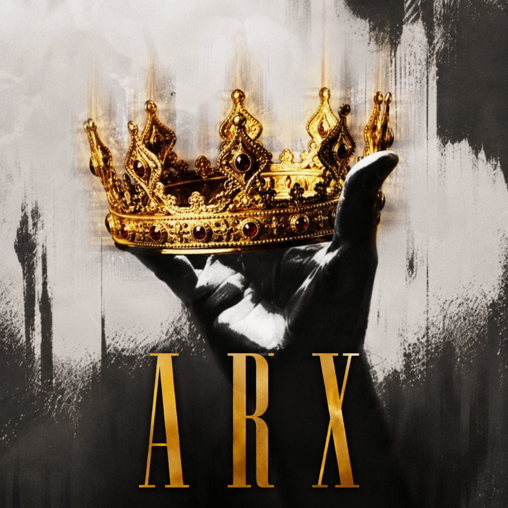

# 👑 ARX Clan | Official Minecraft PvP Tier List

<p align="center">
  
</p>

<p align="center">
  <strong>"Crown the Victorious. Settle for Nothing Less."</strong>
</p>

<p align="center">
  
  
  
  
</p>

---

## 🏆 Overview

The **ARX Clan Tier List** is the official competitive ranking portal for the **ARX** Minecraft PvP syndicate. Built strictly referencing the design and competitive hierarchy of [MCTiers.it](https://www.mctiers.it/), customized with the clan's royal crown emblem, imperial burnished gold, and ruby accents.

---

## ⚜️ Official Clan Tier List Hierarchy

```
ARX TIERLIST 🏆
S+ 👑
No winner yet

S 🔰
Jeplicc
noctisonkbm
TheDarkLight836
Hydeeeee
Mactyu
Shekkyyy
CursedXaii

A ⚜️
ARX Bowiee
zObxx
Enigma
OrdinaryGuy
Rocknarok
Voider
ARX Jemi

B 🔱
ARX meme50766
Vielend
Endeirmain
n3tjamesss
M1yamots

C 🎭
Meonyon
OlzychXD

D ☃️
Rizu 63rd
DenBaldDaCow

F ⛄
Alderf
Zach

Retired 🫡
J3sterbox (S)
ColdVerdictt (S)
Neoismindd (S)
```

---

## ✨ Features & Architecture

- **MCTiers-Standard Badges**: Authentic High Tier (`HT`) and Low Tier (`LT`) plate badges with top/bottom color bar accents.
- **Retired Legends Badge**: Custom diagonal hatch pattern displaying historical peak rank (e.g. `(S) VET`).
- **Interactive 3D Skin Inspection**: Click any member card to inspect their full Minecraft body render (via `mc-heads.net`), winrate, combat profile, and gamemode masteries.
- **Triple View Layout**:
  - 🏆 **Tier List Rows**: Classic MCTiers / TierMaker tier rows with player chips.
  - 📊 **Ranked Leaderboard**: Complete 1-to-27 ranked standing with gold, silver, and bronze trophies, titles, and points.
  - ⚔️ **Gamemodes Matrix**: Specific breakdown for Sword, Netherite Pot, Diamond Pot, UHC, SMP/Kit, and Mace.
- **Real-Time Live Search**: Instant search filtering (`/` keyboard shortcut).
- **Clan Audio Engine**: Tactile sound effects powered by the Web Audio API synthesizer (no external sound files required) with sound toggle.
- **Roster Simulator & Exporter**: In-browser tools to add members or export the tier list to formatted text with one click.
- **Dual Compatibility**:
  - Run as a **Laravel 12+** web application (`php artisan serve`).
  - Run as a **Zero-Dependency Static Web App** (`public/index.html` or root redirect for GitHub Pages).

---

## 🚀 Getting Started

### Option 1: Standalone Web App
Simply open `public/index.html` in any modern web browser or serve via any static web server:
```bash
# Using Python
python -m http.server 8000

# Or open public/index.html directly in your browser
```

### Option 2: Laravel Development Server
```bash
# Serve via PHP
php artisan serve
# Open http://127.0.0.1:8000
```

---

## 🎨 Color Palette Reference

| Token | Hex | Role |
| :--- | :--- | :--- |
| **Imperial Gold** | `#F5C542` / `#FFD700` | Clan Branding, Crown Trim, S-Tier Glow |
| **Obsidian Dark** | `#07070A` / `#0D0D12` | Gritty Background & High-contrast Panels |
| **Ruby Jewel** | `#E63946` / `#C1121F` | Accent Jewels & Alerts |
| **Royal Purple** | `#C084FC` | Tier A (Knights) |
| **Trident Cyan** | `#38BDF8` | Tier B (Gladiators) |
| **Emerald Jade** | `#34D399` | Tier C (Wardens) |
| **Frost Slate** | `#94A3B8` | Tier D (Initiates) |
| **Ash Crimson** | `#F87171` | Tier F (Recruits) |

---

## 📜 Credits

- **Clan**: ARX Syndicate
- **Standards & Inspiration**: [MCTiers.it](https://www.mctiers.it/)
- **Minecraft Skin Renders**: [mc-heads.net](https://mc-heads.net/) & [Minotar](https://minotar.net/)
